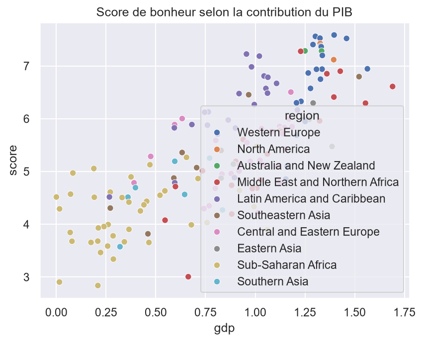
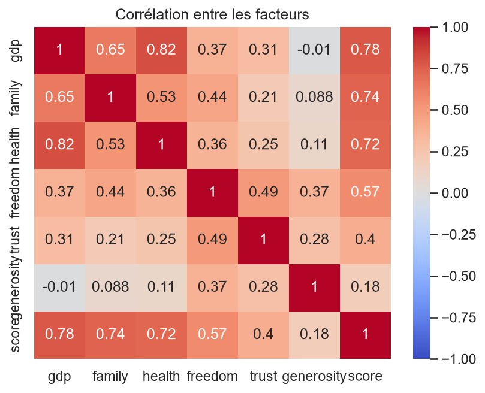
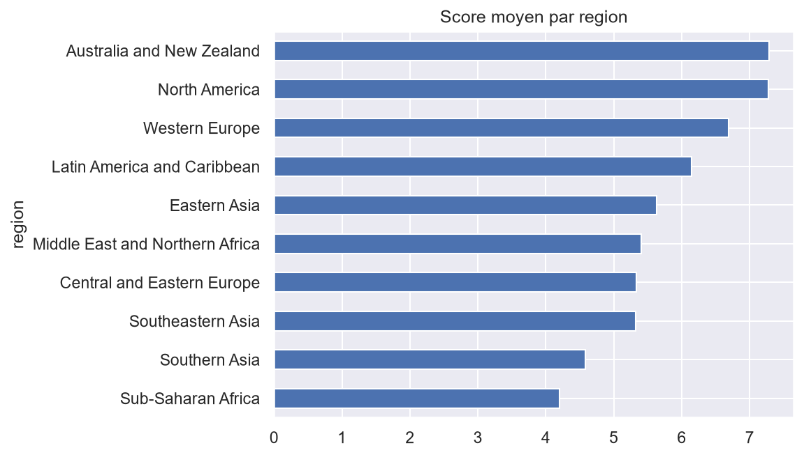

# Qu'est-ce qui explique le bonheur d'un pays ? (World Happiness Report 2015)

## Objectif
Analyser 158 pays pour identifier les facteurs associés au score de bonheur.

## Données
World Happiness Report 2015 (Kaggle) : 158 pays, 12 colonnes. Les facteurs
(PIB, famille, santé...) sont des contributions au score, pas des valeurs brutes.

## Méthode
- Nettoyage et exploration : pandas, numpy
- Visualisation : matplotlib, seaborn
- Modélisation : régression linéaire standardisée et validation croisée (scikit-learn)

## Résultats
- Facteurs les plus associés au score : famille, PIB, santé. La générosité a l'association la plus faible.
- Régression linéaire : R² moyen en validation croisée 5 plis = 0,74 (± 0,05).
- Afrique subsaharienne : région la plus basse (n = 40, résultat robuste).
- Australie/Nouvelle-Zélande et Amérique du Nord : scores les plus élevés, mais sur 2 pays chacune.

- 

## Limites
- Corrélation n'est pas causalité.
- Multicolinéarité entre PIB et santé (corrélation de 0,82).
- Une seule année de données, 158 observations.
- Un premier essai de validation croisée sans mélange donnait des R² très négatifs
  (données triées par rang). Corrigé avec KFold(shuffle=True).

## Reproduire
1. `pip install -r requirements.txt`
2. Ouvrir `notebooks/01_exploration.ipynb`
